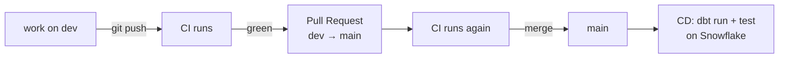

# Banking Data Pipeline

An end-to-end data pipeline for banking data. Changes in an operational Postgres database are captured in real time with **Debezium (CDC)** and streamed through **Kafka**. They land in a **MinIO** data lake as Parquet and are loaded into **Snowflake** by **Airflow**. **dbt** then models them into a star schema with SCD Type 2 history. **GitHub Actions** handles CI/CD.

## Architecture

```mermaid
flowchart LR
    G[Data Generator<br/>Faker + Python] -->|INSERT| PG[(Postgres<br/>OLTP)]
    PG -->|WAL logical replication| DBZ[Debezium<br/>Kafka Connect]
    DBZ -->|CDC events| K[[Kafka<br/>3 topics]]
    K -->|batch of 50| C[Consumer<br/>kafka_to_minio.py]
    C -->|Parquet| M[(MinIO<br/>data lake)]
    M -->|Airflow DAG<br/>every minute| SF[(Snowflake<br/>RAW)]
    SF -->|dbt| STG[Staging views]
    STG -->|dbt snapshot<br/>daily| SNAP[SCD2 snapshots]
    SNAP --> MART[Marts<br/>dims + fact]
    STG --> MART
```



| Stage | Tool | Code |
|---|---|---|
| 1. Generate data | Python, Faker | [data-generator/data_generate.py](data-generator/data_generate.py) |
| 2. Source database | Postgres 15 (`wal_level=logical`) | [postgres/schema.sql](postgres/schema.sql) |
| 3. Change data capture | Debezium 2.2 on Kafka Connect | [kafka-debezium/generate_and_post_connector.py](kafka-debezium/generate_and_post_connector.py) |
| 4. Streaming | Kafka + Zookeeper | [docker-compose.yml](docker-compose.yml) |
| 5. Land in the lake | Python consumer → MinIO (Parquet) | [consumer/kafka_to_minio.py](consumer/kafka_to_minio.py) |
| 6. Load to warehouse | Airflow → Snowflake `PUT` / `COPY INTO` | [docker/dags/minio_to_snowflake_dag.py](docker/dags/minio_to_snowflake_dag.py) |
| 7. Transform | dbt (staging → snapshots → marts) | [banking_dbt/](banking_dbt/) |
| 8. Orchestrate dbt | Airflow | [docker/dags/scd_snapshots.py](docker/dags/scd_snapshots.py) |
| 9. CI/CD | GitHub Actions | [.github/workflows/](.github/workflows/) |

## How the data flows

### 1. Source: Postgres
There are three tables: `customers` → `accounts` → `transactions` (each linked by a foreign key). Each run of the generator inserts 10 customers, 2 accounts per customer and 50 random transactions (`DEPOSIT`, `WITHDRAWAL` or `TRANSFER`). It repeats every 2 seconds. Pass `--once` to run a single batch.

### 2. CDC: Debezium → Kafka
The connector reads the Postgres WAL through the `pgoutput` plugin and the replication slot `banking_slot`. It publishes every row change to one topic per table:

- `banking_server.public.customers`
- `banking_server.public.accounts`
- `banking_server.public.transactions`

### 3. Lake: Kafka → MinIO
The consumer keeps only the `payload.after` row image (the row after the change). It buffers rows per topic and writes each batch of 50 to MinIO as Parquet, partitioned by date:

```
s3://<bucket>/<table>/date=YYYY-MM-DD/<table>_<HHMMSSffffff>.parquet
```

### 4. Warehouse: MinIO → Snowflake (Airflow)
The `minio_to_snowflake_banking` DAG runs every minute:
1. `download_minio` downloads the Parquet files for each table.
2. `load_snowflake` `PUT`s the files to each table's stage, then runs `COPY INTO` on the RAW tables (`BANKING.RAW.*`).

The staging models read rows as `v:<column>`. Each RAW table therefore needs a single `VARIANT` column named `v`.

### 5. Modeling: dbt
```
RAW (variant)
  └─ staging (views)       stg_customers, stg_accounts   ← deduplicated, latest row per id
                           stg_transactions
       └─ snapshots (SCD2) customers_snapshot, accounts_snapshot
            └─ marts       dim_customers, dim_accounts   ← effective_from / effective_to / is_current
                           fact_transactions             ← incremental, joined to accounts for customer_id
```

The `SCD2_snapshots` DAG runs daily: `dbt snapshot` first, then `dbt run --select marts`.

## Running locally

### Prerequisites
- Docker and Docker Compose
- Python 3.11+
- A Snowflake account

### 1. Configure environment variables
Each component reads its own `.env` file. `.env` files are git-ignored, so you must create them yourself.

| File | Keys |
|---|---|
| `.env` (root, used by docker-compose) | `POSTGRES_USER`, `POSTGRES_PASSWORD`, `POSTGRES_DB`, `MINIO_ROOT_USER`, `MINIO_ROOT_PASSWORD`, `AIRFLOW_DB_USER`, `AIRFLOW_DB_PASSWORD`, `AIRFLOW_DB_NAME` |
| `data-generator/.env` | `POSTGRES_HOST`, `POSTGRES_PORT`, `POSTGRES_DB`, `POSTGRES_USER`, `POSTGRES_PASSWORD` |
| `kafka-debezium/.env` | the same Postgres keys (see the note below) |
| `consumer/.env` | `KAFKA_BOOTSTRAP`, `KAFKA_GROUP`, `MINIO_ENDPOINT`, `MINIO_ACCESS_KEY`, `MINIO_SECRET_KEY`, `MINIO_BUCKET` |
| `docker/dags/.env` | the MinIO keys above, plus `MINIO_LOCAL_DIR`, `SNOWFLAKE_USER`, `SNOWFLAKE_PASSWORD`, `SNOWFLAKE_ACCOUNT`, `SNOWFLAKE_WAREHOUSE`, `SNOWFLAKE_DB`, `SNOWFLAKE_SCHEMA` |

Which hostname to use depends on where the code runs:
- **Scripts on your machine** (generator, consumer): `POSTGRES_HOST=localhost`, `KAFKA_BOOTSTRAP=localhost:29092`, `MINIO_ENDPOINT=http://localhost:9000`
- **Inside Docker** (Airflow DAGs): `MINIO_ENDPOINT=http://minio:9000`
- **Debezium connector**: Kafka Connect itself opens the connection to Postgres, so set `POSTGRES_HOST=postgres` and `POSTGRES_PORT=5432`.

### 2. Start the stack
```bash
docker compose up -d --build
```

| Service | URL |
|---|---|
| Airflow | http://localhost:8080 |
| MinIO console | http://localhost:9001 |
| Kafka Connect REST | http://localhost:8083 |
| Kafka (from host) | `localhost:29092` |
| Postgres (banking) | `localhost:5432` |
| Postgres (Airflow metadata) | `localhost:5433` |

### 3. Create the source tables
```bash
docker compose exec -T postgres psql -U <POSTGRES_USER> -d <POSTGRES_DB> < postgres/schema.sql
```

### 4. Register the Debezium connector
```bash
pip install -r requirements.txt
python kafka-debezium/generate_and_post_connector.py
```

### 5. Start the consumer and the generator
In two separate terminals:
```bash
python consumer/kafka_to_minio.py
python data-generator/data_generate.py        # or --once for a single batch
```

### 6. Turn on the Airflow DAGs
In the Airflow UI, unpause `minio_to_snowflake_banking` and `SCD2_snapshots`. dbt inside Airflow reads its profile from `banking_dbt/.dbt/profiles.yml`, which is mounted into the container.

## CI/CD and Git workflow



### Branches
- **`dev`**: all day-to-day work goes here. Never commit directly to `main`.
- **`main`**: production. Code reaches it only through a Pull Request from `dev`, and every merge deploys.

### CI: [ci.yml](.github/workflows/ci.yml)
Triggered by a push to `main` or `dev`, or by a PR into `main`.

| Step | What it checks |
|---|---|
| Install dependencies | `requirements.txt` and `dbt-snowflake` install cleanly |
| Lint | `ruff check .` passes, including import sorting (`I001`) |
| Unit tests | `pytest tests/` (no tests exist yet, so this step never fails) |
| dbt compile | dbt models compile against Snowflake (SQL/Jinja are valid and credentials work) |

### CD: [cd.yml](.github/workflows/cd.yml)
Triggered by a push to `main`, which includes merging a PR. It runs `dbt deps`, `dbt run` and `dbt test` against Snowflake using the `prod` target.

### Day-to-day loop
```bash
git checkout dev
git pull origin dev

# ... make changes ...
ruff check --fix .                      # same lint that CI runs
git add <files>
git commit -m "feat: ..."
git push origin dev                     # CI runs

# open a PR dev → main on GitHub, wait for CI to pass, then merge  → CD runs

git checkout main && git pull           # keep local main in sync after merging
git checkout dev && git merge main
```

### Required GitHub secrets
Settings → Secrets and variables → Actions:

`SNOWFLAKE_ACCOUNT`, `SNOWFLAKE_USER`, `SNOWFLAKE_PASSWORD`, `SNOWFLAKE_WAREHOUSE`, `POSTGRES_USER`, `POSTGRES_PASSWORD`

## Project structure
```
.
├── data-generator/          # fake banking data → Postgres
├── postgres/schema.sql      # source tables
├── kafka-debezium/          # registers the Debezium Postgres connector
├── consumer/                # Kafka → MinIO (Parquet)
├── docker/dags/             # Airflow DAGs (MinIO → Snowflake, dbt snapshots)
├── banking_dbt/             # dbt project (staging, snapshots, marts)
├── docker-compose.yml       # Kafka, Zookeeper, Connect, Postgres, MinIO, Airflow
├── dockerfile-airflow.dockerfile
├── requirements.txt
└── .github/workflows/       # CI and CD
```

## Roadmap
- Add unit tests in `tests/` and remove `|| echo` from the CI test step so failing tests fail the build
- Add dbt tests (`unique`, `not_null`, `relationships`) to the models
- Use separate Snowflake schemas for CI and prod (both currently use `BANKING.ANALYTICS`)
- Replace `ACCOUNTADMIN` with a least-privilege role for CI/CD
- Pin the `ruff` version in CI
